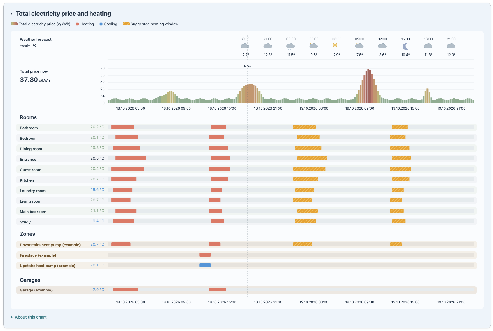

# ThermalPilot

Shift electric heating toward cheaper electricity periods while keeping rooms
within their comfort limits. ThermalPilot learns each room’s heating and cooling
response and shows proposed schedules before you enable real control.

Version **0.9.92 — experimental simulation-first Home Assistant custom integration**.

## Why I built this

I’ve wanted to build an integration like this for some time. Home Assistant
automations can handle basic heating control well, but more complex decisions
become difficult to manage with fixed rules. Heating during the cheapest spot-price
periods usually works—until those periods are 24–36 hours apart. If rooms cool too
much in between, heating may be needed during the most expensive hours instead.

I wanted a system that learns how the house responds and plans ahead, rather than
following a static chain of rules. ThermalPilot is my attempt to meet that need,
with charts available both in its own panel and as dashboard cards.

Development is ongoing. I can test real-world behavior only with my own heating
system, so I can’t cover every installation or scenario myself. If you try
ThermalPilot, I’d welcome your feedback through
[GitHub issues](https://github.com/jvuotila/ThermalPilot/issues).

The integration starts in simulation mode and does not control your heating by
default. Give it an extended observation period to learn your system, then assess
its forecasts and plans before considering live control. Learning alone does not
guarantee reliability. You can also use ThermalPilot purely to monitor your
heating system, without ever letting it control anything.

## What it does

- Plans heating using electricity prices, room temperatures and weather.
- Shows room plans, recorded heating and saved temperature forecasts.
- Aligns recorded outdoor temperatures with prices and heating timelines in History,
  with future weather forecasts shown separately as a grey dashed line.
- Fills the past part of the Plan weather strip with faded saved forecasts.
  One hourly snapshot is shared across rooms and kept for seven days. Its temperature
  and condition are frozen when the target hour begins; these are forecasts, not
  observed weather. History builds after installation and survives restarts and backups.
- Supports primary room thermostats, secondary air-to-air heat-pump zones and
  independent garage control.
- Includes sortable heat-retention estimates and two dashboard cards.
- Works on phones and supports 25 interface languages.

Tariff optimization is intended for heat pumps and electric resistance heating
with variable electricity prices. Gas, oil, wood and district heating support
observation and learning; their fuel costs and equipment control are not modeled.

## Install

### Install with Home Assistant Marketplace (recommended)

[Home Assistant Marketplace](https://www.home-assistant.io/integrations/marketplace/)
comes with Home Assistant 2026.11 and later and replaces HACS. Existing HACS
installations migrate automatically.

1. Open **Settings → Marketplace**. Accept the first-use notice if prompted.
2. Click the button below to open ThermalPilot. Connect GitHub and confirm adding
   the repository if prompted, then select **Install**.

   

3. Restart Home Assistant.
4. Open **Settings → Devices & services → Add integration**, search for
   **ThermalPilot**, and follow the setup steps.
5. Open **ThermalPilot** in the sidebar and follow [Get started](#get-started).

If the button does not work, open **Settings → Marketplace → Add from link**,
enter `https://github.com/jvuotila/ThermalPilot`, and select **Add**. If asked for
**Type**, choose **Integration**. Open ThermalPilot's repository page and select
**Install**, then continue from step 3 above. Adding a custom repository requires
a GitHub connection; Marketplace guides you through it.

To update ThermalPilot, open **Settings → Updates**, install the available update,
and restart Home Assistant.

### Manual installation

1. Download the repository and copy its `custom_components/thermal_pilot` folder
   into your Home Assistant configuration's `custom_components` directory.
2. Restart Home Assistant.
3. Open **Settings → Devices & services → Add integration → ThermalPilot**,
   then follow [Get started](#get-started).

## Get started

1. In **Settings**, select your outdoor-temperature source and choose a price
   sensor or **Static price**. For a sensor, match its price unit; for a fixed
   tariff, enter the total price in c/kWh. Include the consumption-based charges
   you want scheduling to consider. See [electricity tariffs](#electricity-tariffs).
2. In **Rooms and zones**, choose the house heating system and add each room’s
   thermostat and temperature sensor. Follow the [sensor placement guidance](#temperature-sensor-placement)
   before starting learning, then set targets and comfort limits.
3. Keep **Enable simulation** on and **Apply season setpoints** off for a trial
   that does not change thermostats. Keep your existing heating controls running.
4. Work through [Before you start learning](#before-you-start-learning), then
   review **Plan** and **History** as observations accumulate. Use field info
   buttons for setting-specific help.

Zones are secondary sources: adding a heat-pump zone preserves each room’s
primary thermostat and heating plan. New zones are observation-only until their
own control switch is enabled.

## Temperature sensor placement

Place each sensor where it measures the room's representative air temperature,
away from local heat sources and cold drafts. ThermalPilot uses these readings to
learn how the room heats and cools; a sensor heated by sunlight or an appliance
can produce misleading forecasts and heat-retention estimates.

- Keep it out of direct sunlight throughout the day, including sunlight that
  reaches the location in other seasons.
- Keep it away from radiators, fireplaces, stoves and cooking appliances such as
  ovens and air fryers.
- Avoid the direct airflow from heat pumps, air conditioners and ventilation
  outlets, as well as drafts from doors or windows.
- Choose a location at normal occupied height with air circulating around it.
  Avoid the ceiling, floor, cold exterior surfaces, enclosed shelves and spots
  behind curtains or furniture. Follow the sensor manufacturer's mounting guidance.
- Keep the location consistent. After handling or moving the sensor, let its
  reading settle before judging room temperature or model behaviour.

The aim is to measure the temperature people experience in the room, rather than
an unusually warm or cold spot. ThermalPilot cannot reliably correct a poorly
placed sensor. Its filter for rapid temperature changes does not remove every
misleading reading, particularly the slower cooling after a local heat spike.

If a sensor has been learning in an unsuitable location, move it first and let it
settle. Consider resetting learning for that room using its circular-arrow button
under **Rooms and zones**. This clears the learned parameters while retaining
observation history; the room then needs fresh heating and idle observations.

## Heating circuits sharing an open space

A ThermalPilot room can represent a heating circuit rather than a separate
physical room. For example, a kitchen and two living-room floor loops may heat
one open space while retaining separate thermostats and sensors.

Under **Rooms and zones**, open a room and use **Shared air space → Add room**
to select the other circuits in that open space. Add as many as needed. Links
work both ways: selecting B in A also links A in B. Each selection describes a
direct connection. A–B and B–C do not automatically add A–C. Removing a selection
removes only that pair, leaving other connections intact.

For example, Keittiö can link only to Olohuone 2, while Olohuone 2 links to both
Keittiö and Olohuone 1, and Olohuone 1 links only to Olohuone 2. The planner still
compares this connected network together, but models direct heat transfer only
along the selected connections. Indirect effects pass through the intermediate
room rather than creating another direct link.

Each circuit keeps its own thermostat, relay, temperature sensor, target and
comfort limits. Sensors are not averaged or replaced. Leave separate enclosed
rooms unlinked, even if one water circuit serves several of them; a representative
average sensor remains an option for that single circuit. Heat-pump zones remain
secondary heat sources and use their existing settings.

ThermalPilot learns how temperature differences between linked sensors transfer
warmth, alongside each circuit's own heating response and heat loss. Existing
learned parameters and observation history are retained. A new transfer fit needs
at least **12 accepted heating hours and 12 accepted idle hours per circuit**
with linked sensors available; these are observation hours, not a promise that
assistance starts after one day. Similar sensor readings may provide little
information about transfer. The model is an approximation, not a measurement
of circuit power or water flow.

After that fit is available for all members, the planner compares linked
schedules together. It can add a boost through a helper circuit and reduce work
on a colder circuit when the combined forecast improves. It keeps each circuit's
targets, temperature limits, minimum runs and existing run commitments. It does
not automatically boost every circuit. Costs use the same normalized heating
estimate as other plans; actual circuit powers are not measured.

Missing linked readings, cooling, an active fireplace or secondary heat pump
pause shared-space learning and coordination. An active manual session also
leaves planning independent for that group, preserving manual-control priority.
Ordinary independent planning remains available while transfer learning is
incomplete. Changing direct connections or their sensor/controller sources starts
a fresh transfer fit while retaining the existing room history and parameters.

Rooms served directly by the same heat pump may select that pump as their
thermostat and join its zone. The zone is then the only physical pump controller;
room entries provide their individual temperature readings. This also applies
when the zone controller is disabled: linked entries do not take over the pump.
A different room thermostat, such as an electric floor heater, stays independent.
Independent rooms and separate zones still cannot compete for the same pump.

## Heat pump with electric floor assistance

For a room heated by both an air-to-air heat pump and an electric floor, keep
both controllers configured. Under **Rooms and zones**, choose **Electric
resistance** as the house heat source and **Electric floor heating** as the
heat distribution. Keep each room’s floor thermostat as its **Thermostat**.
Add the pump under **Zones**, link the rooms it serves, and enable zone control.

In each participating room, set **Heating priority → Heat pump preferred**.
Then choose **Allow floor assistance below target by (°C)**, initially **0.5 °C**.
For a 20 °C room target, the floor stays at a 19.5 °C reserve target while the
pump maintains comfort. If the room reaches that reserve, the floor assists
and the pump continues heating. After observing the pump’s room-temperature
response for 30 minutes, a falling trend can request floor assistance earlier
to account for the configured floor response lag. This needs no outdoor
cutoff or pump COP curve. A price source is needed only if another room or
zone still uses tariff scheduling.

The existing **Minimum flexible heating run (minutes)** protects the assistance
request, including across Home Assistant restarts. After that minimum, as the
room recovers, the floor request returns toward its normal target and then reserve; its own
thermostat still decides actual relay demand. Temperature protections, manual
sessions, cooling and solar heating keep their precedence. An unavailable pump
allows floor backup. Unlinking or disabling the pump zone restores independent
floor control. **Independent** is the default for existing installations.

This is capacity-based assistance, not measured efficiency or COP optimization.
The combined forecast is conditional on an observed pump-on temperature trend;
it remains unavailable until there is enough evidence. Mixed-source periods
and residual heat are excluded from individual source fitting so the floor is
not credited with the pump’s heat or vice versa. Existing learned parameters
are retained. The room flame tooltip shows the current assistance decision;
actual heating indicators continue to describe observed device activity.

## Electricity tariffs

The price source starts as **Not configured**. You can save settings in that
state and finish choosing the house heat source under **Rooms and zones**.
Oil, gas, wood, pellet and district heating do not require an electricity price
for observation and learning. Separate electric rooms or zones using tariff
scheduling still need one.

For electric tariff planning, choose a source under
**Settings → Electricity price settings → Price sensor**:

- **A price sensor** supplying timestamped prices or today/tomorrow lists, with
  its matching source price unit. Use this for spot prices or any tariff whose
  total price varies by time.
- **Static price**, then enter **Static price (c/kWh)**. If you add transfer
  charges separately below, enter the energy price without those charges.
  Otherwise enter the total per-kWh price. No price sensor or price forecast is
  needed in this mode.

- **Nord Pool (Home Assistant)** reads the official integration’s price action.
  Choose its integration and price area, then enter applicable VAT and retailer
  margin. This is separate from the community Nord Pool sensor option above.
- **Tibber (Home Assistant)** reads the official integration’s price action for
  the home identified by the selected Tibber price sensor. EUR/kWh is supported.

Until a price source is configured, tariff heating plans are unavailable.
Observation and learning can continue with valid inputs; enabled live controllers
use their normal fallback behaviour instead of a tariff plan.

**Transfer tariff** controls optional charges added to the selected price:

| Option | What to enter |
| --- | --- |
| Already included / no addition | Nothing. This is the default for existing installations and total-price sensors. |
| Fixed transfer price | One additional transfer price in c/kWh. |
| Day/night transfer prices | Day and night start times and their respective c/kWh prices. |

For example, set a static energy price of **8 c/kWh**, day starts **07:00** at
**7.45 c/kWh**, and night starts **22:00** at **5.68 c/kWh**. The resulting total
is **15.45 c/kWh** during the day and **13.68 c/kWh** at night. The same transfer
settings also work with a variable energy-price sensor.

The daily schedule follows Home Assistant's configured time zone, including
summer/winter clock changes. Both start times are editable; the night period can
cross midnight. Rates repeat every day without weekend, holiday or seasonal
exceptions. A boundary inside a planning interval uses the duration-weighted
average fee for that interval.

Include applicable taxes in your entered per-kWh components, but never add the
same charge twice. Fixed monthly fees are excluded. If your selected sensor
already combines energy and transfer, leave **Already included / no addition**
selected. More complex schedules still need a custom total-price sensor supplying
future price lists; see the [total electricity price example](docs/configuration-examples/total-electricity-price.md).

A fixed energy price with day/night transfer rates still has different total
costs at different hours. With an entirely fixed total price, there is no cheaper
hour to favour. In both cases ThermalPilot uses room measurements, comfort limits
and weather; the tariff does not make thermal predictions inherently more accurate.

## Heating with solar production

Under **Settings → Solar power heating settings** (Finnish:
**Aurinkovoimalan lämmitysasetukset**), select an instantaneous solar production
sensor in **W or kW**. Leave the sensor empty to disable this optional feature.
It is disabled for existing installations until a sensor is selected.

- **Start solar heating above (kW)**: default **4 kW**. Production must stay
  above this limit for five minutes before a new solar request can start.
- **Stop solar heating below (kW)**: default **1 kW**. Five minutes at or below this
  limit ends the production cycle. Between the limits, existing requests continue.
  The stop limit must be lower than the start limit.
- **Minimum solar heating session (minutes)**: default **30 minutes**, separate
  from the normal flexible heating minimum. A request continues until its own
  minimum has elapsed, even if the production cycle has ended. If production
  remains sufficient, the request can continue beyond that minimum.

Solar heating uses existing room boosts, thermostat controllers and heat-pump
settings. It can request heating without an electricity-price source. Ordinary
rooms stop their solar request at target plus boost, bounded by the configured
maximum; garages use their own upper temperature limit. A completed room is
not repeatedly restarted during the same production cycle. Automatic solar
heating is limited to winter operation and does not reverse active cooling.

Manual sessions, disabled control, missing required inputs and temperature/door
protections take priority over the solar minimum. Missing, invalid or stale
production readings cancel solar requests; readings older than 15 minutes are
unusable. Existing normal heating remains independent and may continue after a
solar request ends. Solar sessions preserve their original minimum deadline
across Home Assistant restarts. Threshold confirmation restarts after downtime.
Restoring a backup clears active solar requests and retains simulation-first
behavior.

**Production is not surplus power.** The selected reading is total generation,
not generation minus household loads. Several eligible controllers may request
heat together; this version does not allocate a measured power budget between
rooms. Other appliances, clouds or completion of a minimum run can require grid
electricity. Select thresholds appropriate to your installation.

Simulation shows solar requests without controlling devices; confirmed live
control is required to apply them. The room flame tooltip identifies a solar
request and its minimum deadline. Actual heating still comes from observed
relay/thermostat activity, so a request never creates fictitious heating hours.
Tariff charts and temperature forecasts remain the price-based plan; they do not
predict future PV production. Actual solar-driven heating appears in the observed
heating history and influences subsequent learning and replanning. This feature
uses a live production sensor, not Solcast or another PV forecast.

## Away heating and cooling

Under **Settings → Away heating and cooling**, immediately below solar heating,
set the **Away heating temperature** (initially 16 °C) and **Away cooling
temperature** (initially 26 °C). These are fixed room targets: heating never
raises an already lower normal target, and cooling never lowers an already
higher normal cooling target. Automatic detection starts disabled.

Enable **Automatic away detection**, select the Home Assistant home zone, and
choose an **Absence delay** (initially 24 hours). ThermalPilot reads the zone’s
tracked-person count, not individual phone states. Everyone must remain away
continuously for the entire delay; a return resets it. Configure people and
location tracking correctly in Home Assistant first. Unknown or unavailable
counts pause automatic absence detection and restore normal automatic targets.
The confirmed absence timer survives restarts.

The header calendar icon opens a date-range calendar with start and end times.
Calendar bookings work with automatic detection disabled. In that mode, they
end only at the selected time or through **Cancel period** in the popup. With
automatic detection enabled, a detected return also cancels an active booking;
a future booking made while home waits for departure. Dates use Home Assistant’s
time zone, even when the browser is travelling. Normal targets resume at the
end or on return; there is no advance warm-up, so room recovery takes time.
Cancelling a booking does not disable automatic detection: its away targets
can remain active if the absence delay has already elapsed.

For aquariums or other sensitive rooms, enable **Keep normal temperature during
absences** in that room’s settings. This exempts heating and cooling. A shared
heat-pump zone preserves all its members’ normal targets if any member is
exempt; a single pump cannot maintain separate room targets. Garages always
retain their own limits. Tooltips beside the settings and in the calendar
explain these rules without adding permanent text to the main views.

Away targets override planned and solar heating boosts and temporarily pause
floor-assistance boosts. Explicit manual heating/cooling sessions keep their
priority. Normal control resumes afterwards. Confirmed live control and the
master switch still govern device commands; simulation sends no commands.
Away heating can intentionally be below the normal comfort minimum, but device
limits still apply. Existing cooling controls use the warmer away target; no
active cooling model or new cooling-capable heating system is inferred.
Calendar bookings and timers persist across ordinary restarts. Importing a
backup clears bookings and runtime absence state, preserving learned models.

## Source compatibility and checks

Your existing [community Nord Pool](https://github.com/custom-components/nordpool)
sensor can remain selected under **Price sensor**. Match **Source price unit**
to its configured output: c/kWh, €/kWh or €/MWh. Its VAT and additional costs
are retained; ThermalPilot does not add them again. Add transfer charges only
when they are absent from the selected sensor.

| Source | How ThermalPilot reads it | Automated coverage |
| --- | --- | --- |
| Community Nord Pool | Sensor attributes: timestamped `raw_today` / `raw_tomorrow`, or complete 24/96-value daily lists | Documented sensor-format fixtures; existing installations retain their selection |
| Official Home Assistant Nord Pool | `nordpool.get_prices_for_date`, explicitly requesting EUR; EUR/MWh converted to c/kWh | Synthetic action-response fixtures; not yet verified on a live installation |
| Official Home Assistant Tibber | `tibber.get_prices`, matching the selected sensor’s home; EUR/kWh converted to c/kWh | Synthetic action-response fixtures; not yet verified on a live installation |
| Weather entities | Common `weather.get_forecasts` action: hourly, then twice daily, then daily; legacy forecast attribute fallback | Action fallback tests, timestamp validation and Celsius/Fahrenheit/Kelvin conversion tests |
| Other price sensors | The same recognized sensor-list formats | Generic parser tests; a provider name alone does not guarantee compatibility |

For the official Nord Pool source, prices exclude retail additions: enter your
VAT percentage and your retailer margin **including VAT**. For Tibber, energy
taxes are already included. Configure any missing network/transfer charges
separately, and avoid adding a component twice. Other currencies are not converted.
The existing sensor path continues to use the explicitly selected source unit.

Under **Settings → Weather and forecast settings → Source checks**, choose
**Test sources**. This checks the current draft without saving it or issuing
heating/cooling commands. It shows the normalized units, price interval and
available date range, or an actionable error. It can be used before completing
room setup. Results describe that draft at the time checked, not a guarantee of
future availability.

Native price actions reuse Home Assistant’s existing integrations and credentials;
ThermalPilot does not request provider credentials. Successful native reads are
cached for five minutes and refreshed after a local-date change. Tomorrow’s
unpublished Nord Pool prices leave today’s usable prices available. Missing or
invalid price intervals are not invented. Weather gaps use the current outdoor
reading for planning rather than extending the last forecast indefinitely.
Forecast temperatures and measured temperature-sensor inputs are normalized to
Celsius before calculations. Physical thermostat control still requires supported
Celsius device limits; this does not add Fahrenheit thermostat control.

These tests cover documented response shapes, not every provider or version.
If **Test sources** fails, include the provider/version and the displayed error
in an issue. A redacted example of its timestamped data helps add a regression
test; remove account names, entity IDs and credentials before sharing it.

## Before you start learning

- **Check temperature readings.** Follow the [placement guidance](#temperature-sensor-placement)
  and check that the room and outdoor sensors report plausible values and update
  regularly. Let a sensor settle after handling it.
- **Check heating activity.** Use the room thermostat's reported heating activity
  or select its heating relay as the optional activity source. Verify that it
  changes when that room requests heating. A device being powered on or set to
  Heat mode is not enough. A relay indicates demand, not proof that heat reaches
  the room; water circulation and equipment delays still matter.
  See [sources and room setup](docs/GUIDE.md#sources-and-room-setup) and the
  [room thermostat example](docs/configuration-examples/room-thermostat.md).
- **Account for other heat sources.** Configure secondary heat pumps and observed
  fireplaces where applicable. Unreported heating from another appliance or
  heater can be mistaken for the primary system's output. Check the
  [secondary zone guidance](docs/GUIDE.md#secondary-zones).
- **Check electricity prices.** For a sensor, match the selected unit to the source;
  for **Static price**, use c/kWh. Include
  applicable variable charges, such as VAT, retailer margin and consumption-based
  grid charges or taxes. ThermalPilot does not add these costs. Check that the
  source supplies prices for the expected hours; see the
  [total electricity price example](docs/configuration-examples/total-electricity-price.md).
- **Keep existing heating working during simulation.** Leave **Enable simulation**
  on and **Apply season setpoints** off while observing. Before enabling live
  control, disable competing schedules or automations that change the same
  thermostat targets. Keep the thermostat's own temperature regulation and
  equipment safety controls in place.
- **Review learning after significant changes.** A relocated or replaced sensor,
  different heating equipment, or insulation changes may make earlier observations
  less representative. Settings changes do not automatically reset learning.
  Consider a reset for the affected room once its new readings have settled;
  routine target adjustments do not require starting over. See
  [learning resets and stored data](docs/GUIDE.md#sensor-warnings-and-stored-data).

## Understanding the estimates

- **100% initial collection is not an accuracy score.** It means at least 12
  accepted heating hours and 12 idle hours have accumulated. Learning continues,
  and reaching 100% never enables control automatically. Mild weather may provide
  little heating evidence, so there is no fixed number of days until accuracy.
- **Manual heating contributes to learning.** Collection uses accepted observed
  heating intervals, rather than the requested timer duration. Open or unknown
  garage doors exclude those intervals. Fast air-to-air warmups use an appropriate
  air-temperature guard, while frequent sensor updates accumulate a usable learning
  window. Previously skipped intervals are not automatically backfilled.
- **Phone tooltips are tappable.** Tap an info icon or room-status badge to keep
  its explanation open; tap again or outside to close it without toggling the
  room accordion. Mobile heat-retention tables show room names and cooling badges.
- **Heat retention uses reference conditions.** Rooms still learning show only
  the Learning badge; numeric values appear after their model has adapted.
  The table models cooling from
  20°C indoors with −10°C outdoors, with heating and background gains excluded.
  Its six-hour loss and time per 1°C drop describe those conditions, rather than
  today's expected temperature change. The badges are not certified insulation
  ratings or safe durations for switching heating off.
- **A plan is different from actual heating.** The suggested heating track shows
  planned periods; the recorded track shows observed activity. Raising a
  thermostat target does not guarantee its relay stays on. On the Plan chart,
  red up and blue down arrows indicate the current planned target adjustment;
  hover over an arrow for the amount and target temperatures.
- **Check forecasts against measurements.** Compare saved forecasts with later
  room readings and the no-temperature-change benchmark, including periods where
  actual heating matched the plan. Stable room temperatures alone do not prove
  that heating capacity or timing is modeled correctly.
- **Treat unusual results as a reason to investigate.** Sunlight, cooking, open
  windows, sensor handling and unreported heat sources can distort estimates.
  Check sensor history and heating activity before interpreting a sudden change
  as a change in the room's insulation or cooling speed.

See [learning and interpreting charts](docs/GUIDE.md#learning-and-interpreting-charts)
for more detail.

## Before enabling control

Review forecast accuracy across heating, idle and cold-weather periods before
considering live control. Allow enough observation to understand how your own
system behaves; initial data collection alone does not establish reliability.

To enable scheduled control, turn off **Enable simulation**, save and confirm.
Disable other automations controlling the same thermostats first. **Apply season
setpoints** can also change real thermostats during simulation; leave it off for
observation only. See [control and fallback behavior](docs/GUIDE.md#control-and-fallback).

## Dashboard cards

Both cards load automatically with the integration. Add them from your dashboard’s
card picker:

- **ThermalPilot heat retention** — sortable table with selectable columns.
- **ThermalPilot heating plan** — electricity prices and heating timelines.

Both support an optional title and language override.
[Card configuration and YAML examples](docs/DASHBOARD-CARDS.md).

## Configuration examples and helpers

[Optional examples and helpers](docs/configuration-examples/README.md) to adapt to
your installation: room thermostats, total electricity prices, outdoor and garage
temperatures, and Panasonic Aquarea / HeishaMon heating-water filtering.

## More information

- [Settings and operating guide](docs/GUIDE.md)
- [Screenshot gallery](docs/GALLERY.md)
- [Updating and prototype migration](docs/UPGRADING.md)
- [Model assumptions](docs/MODEL.md)
- [Development and tests](docs/DEVELOPMENT.md) · [Translations](docs/TRANSLATING.md)

## License

[PolyForm Noncommercial 1.0.0](LICENSE). Commercial use is not licensed; versions
through v0.1.40 retain their original MIT terms.

ThermalPilot is experimental software, provided without warranty. Energy savings
are not guaranteed.

### Timed manual heating and cooling

On the **Plan** chart, use the flame before a room or heat-pump zone name to
start a manual heating session. A snowflake is available when the managed heat
pump supports cooling. Heating-only rooms have the flame control as well.
Choose a duration; heat pumps and other direct thermostat controls also offer a
target temperature. Water-circulating systems use the room’s normal configured
heating boost and ask only for the duration. Click either icon again to update
or stop the current session. Hover the icon for its status, target and end time.

A red flame or blue snowflake shows current heating or cooling activity, whether
manual or automatic. A ring marks a timed manual session, including while it is
paused. Grey icons indicate no observed activity or unavailable readings. If a
pump reports only its selected mode, the status explicitly says **Operating mode**.
The popup shows the current activity and control source. You can start a timed
manual session while automatic heating or cooling is already running.

Manual sessions require confirmed live control, an active integration, and an
enabled controller. They temporarily override the automatic plan for that device;
one zone session controls its shared pump. Garage manual heating may exceed the
normal maintenance range, using the chosen working-temperature target. Pump
hardware limits, configured ordinary-room bounds, garage door-open protection
and heating/cooling changeover protection still apply. A mode change may wait
for the existing ten-minute changeover interval before the compressor can run.
The displayed target is a thermostat/pump setpoint, not a promise that the room
will reach that temperature within the selected duration.

The original expiry survives a Home Assistant restart. Expiry or **Stop session**
returns to automatic control, which may continue heating/cooling when needed.
Pausing ThermalPilot, enabling simulation, disabling a zone or changing its device
cancels the session. Importing a backup does not reactivate manual sessions.
Controls are available in the integration's Plan tab; dashboard cards remain
read-only.

### Garage door push alerts

In **Settings → Notifications**, select your Companion app phone under
**Push notification device**. When an open configured door blocks a manual garage
heating/cooling session, ThermalPilot sends a localized push naming the garage
and the open door sensor(s). It makes one notification attempt per explicit
session, rather than notifying on every refresh; updating a session is a new
request. Door protection remains active and the session can start once all
configured doors close, while its original expiry remains unchanged.

No phone is selected automatically. Phone-specific `notify.mobile_app_*` actions
and mobile-app notify entities are supported. The phone must be registered with
Home Assistant and have notification permission in the Companion app; see the
[Companion notification setup](https://companion.home-assistant.io/docs/notifications/notifications-basic/).
