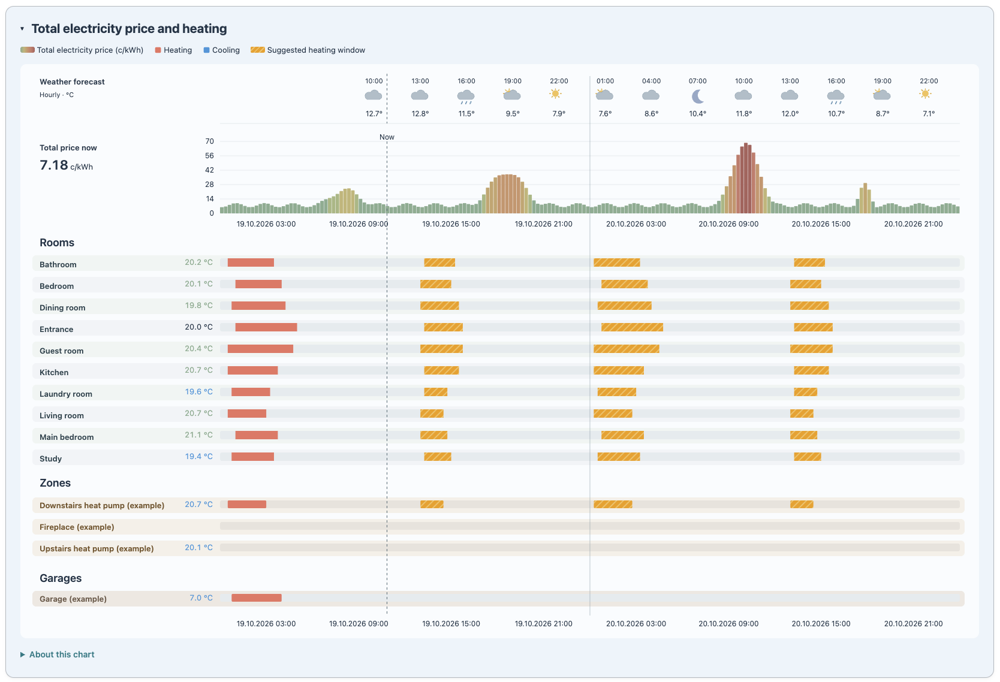
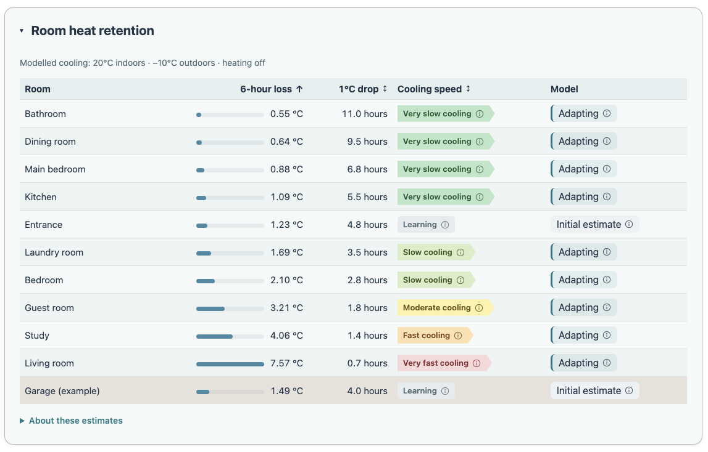
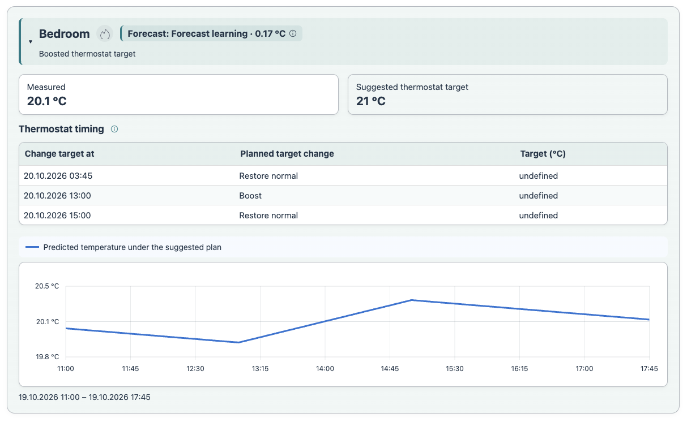
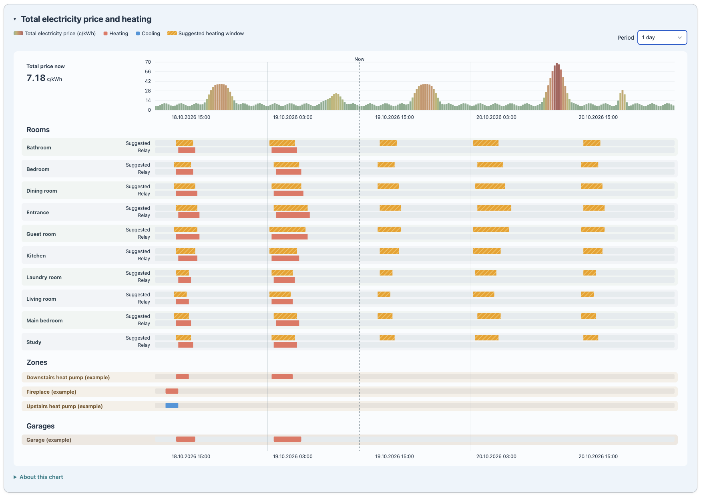
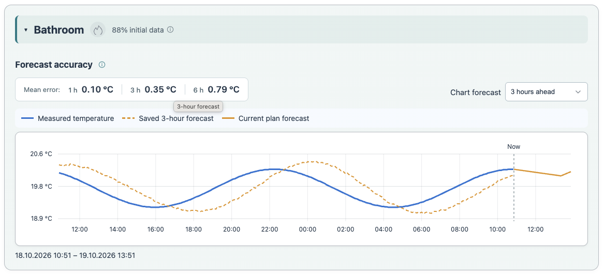
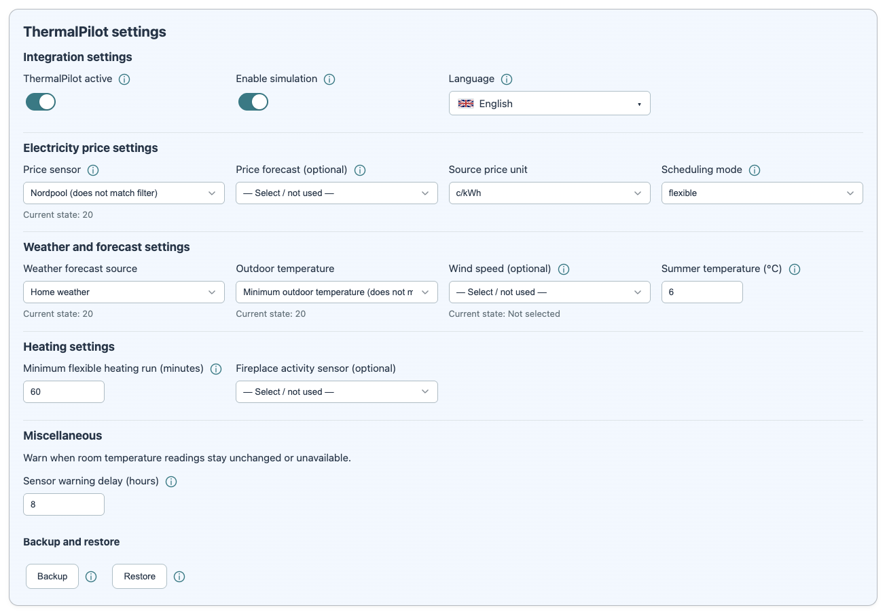
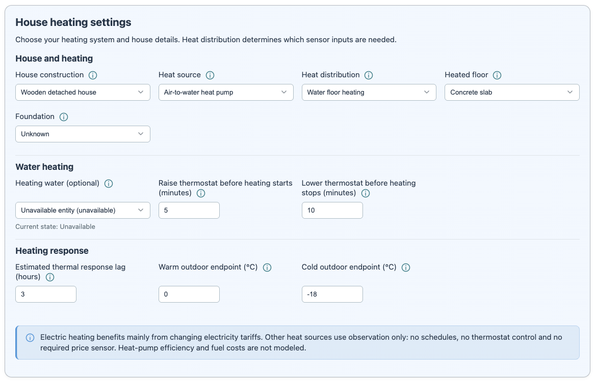
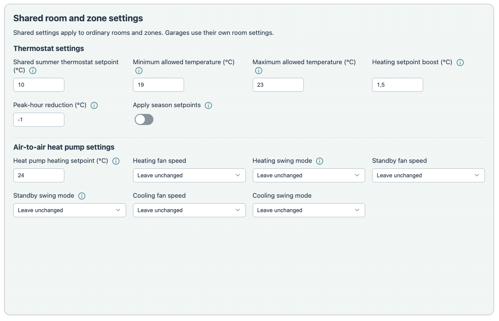
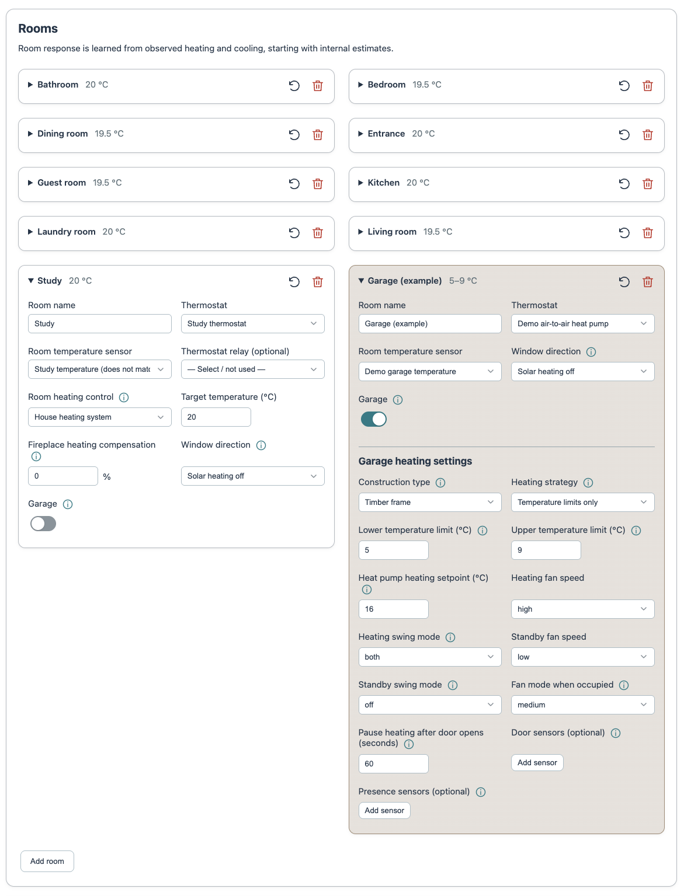
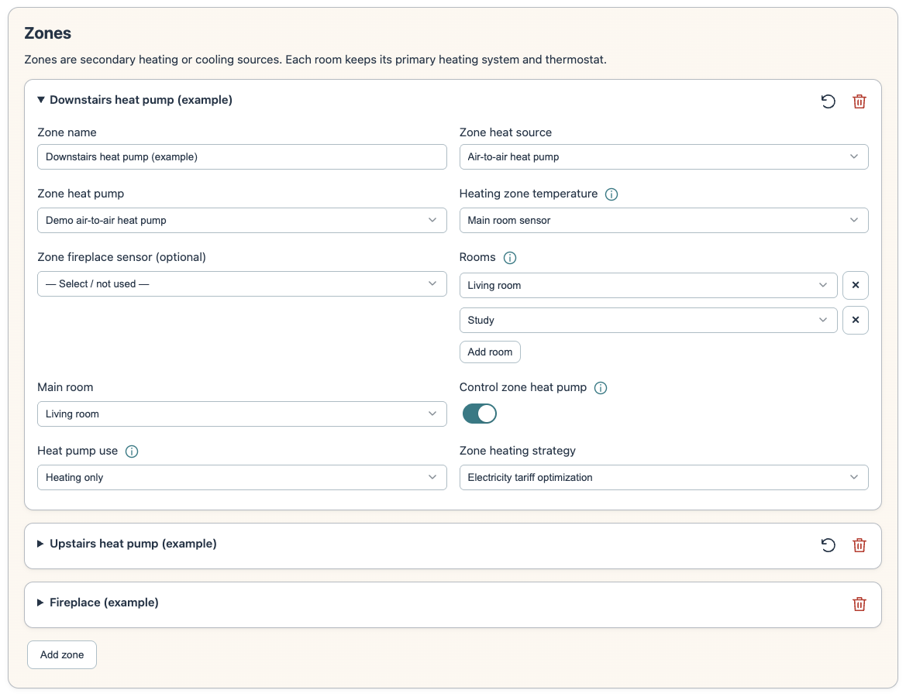

# Screenshots

Examples from the offline preview and a configured Home Assistant installation.
Room names, selected sensors, activity and values are illustrative, not preset
defaults or measured performance claims.

Heat retention, room plans and history

### Room heat retention

### Room plan

### Heating history

### Room history

Settings

### Integration settings

### House heating settings

### Shared room and zone settings

### Rooms

### Zones

Dashboard cards

### Heat retention card

### Heating plan card

